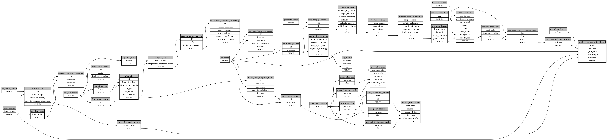

```
# AUTOGENERATED BY ECOSCOPE-WORKFLOWS; see fingerprint in README.md for details

```

```yaml
# fingerprint:
artifacts_sha256_basic: c1fb1480718f6f2af6b88f1a33dd4cdb0e4fc5a1c1705b4f5d2c95905e447cf7
artifacts_sha256_strict: 366ad45c8da8b71b19ec8cbd09a23eff9a3150c91f7432f98f204d5764281a1f
installed_requirements:
- channel: https://repo.prefix.dev/ecoscope-workflows/
  name: ecoscope-platform
  version: {version: ==2.28.0}
- channel: conda-forge
  name: pydeck
  version: {version: ==0.9.2}
params_sha256: 83c325dace4fc460214ab258ceee5e0e197d7b8d13f3dbc4c47c8ce47bd674cb
spec_sha256: f11b77c06d3e9b73c9b640eb99a7c31df851e0226032533b94f26902eb5dddfd

```

# ecoscope-workflows-download-subjects-workflow


